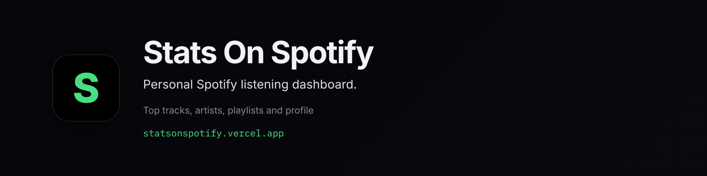

<p align="center"></p>

# Stats On Spotify

Personal Spotify listening **dashboard** (dark, Spotify-inspired UI). Sign in with Spotify to see your top tracks, artists, playlists, and profile.

**Live:** https://statsonspotify.vercel.app

> **Gated demo:** the live app is labeled "Single-account personal use", so most visitors only see the sign-in page. To try it, run it locally with your own Spotify app credentials (see below).

## UX

| State | Route | Experience |
|-------|--------|------------|
| Signed out | `/login` | Dedicated login screen — “Log in with Spotify” |
| Signed in | `/` | Dashboard (featured playlists, genres, top tracks, artists, profile menu) |

`src/proxy.ts` protects `/` (redirects guests to `/login` once) and sends signed-in users away from `/login`.

## Stack

Next.js 16 App Router · React 19 · TypeScript · Auth.js (`next-auth@5.0.0-beta.32`) · Tailwind v4 · shadcn/ui

## Layout

```
src/
  app/                 login + dashboard routes
  auth.ts              Auth.js config
  proxy.ts             auth gate for / and /login
  components/ui/       shadcn primitives
  features/dashboard/  dashboard UI + data hook
  features/auth/       login screen + sign-in button
  server/spotify/      API client + route helpers
```

## Environment variables

Create `.env.local`:

| Variable | Required |
|----------|----------|
| `SPOTIFY_CLIENT_ID` | Yes |
| `SPOTIFY_CLIENT_SECRET` | Yes |
| `AUTH_SECRET` or `NEXTAUTH_SECRET` | Yes |
| `AUTH_URL` or `NEXTAUTH_URL` | Yes in production → `https://statsonspotify.vercel.app` |

Spotify **Redirect URI** (Dashboard):

- `http://localhost:3000/api/auth/callback/spotify`
- `https://statsonspotify.vercel.app/api/auth/callback/spotify`

The Spotify provider in `src/auth.ts` must set `authorization.url` to `https://accounts.spotify.com/authorize` (params-only breaks Auth.js with `Invalid URL`).

## Spotify scopes

Requested at sign-in (`src/lib/spotify/scopes.ts`):

`user-read-email`, `user-read-private`, `playlist-read-collaborative`, `playlist-read-private`, `user-library-read`, `user-top-read`, `user-read-recently-played`, `user-read-currently-playing`, `user-follow-read`

## Tokens and errors

- Sessions use JWTs (`src/auth.ts`). The Spotify access token, refresh token and expiry are stored on the token; once it expires, it is refreshed against `https://accounts.spotify.com/api/token`, keeping the old refresh token if Spotify doesn't return a new one.
- If the refresh fails (or there is no refresh token), the session gets `error: "RefreshAccessTokenError"`. API routes then return `401 Session expired`, and the client shows a "Spotify session expired" toast and starts a new Spotify sign-in.
- `/api/spotify/*` routes return `401 Unauthorized` without a session and `502` with the error message when a Spotify request fails.
- Now playing: a `401`/`403` from Spotify is treated as a missing playback scope, and the card asks you to sign out and reconnect Spotify.

## Scripts

```bash
npm install
npm run dev
npm run build
npm run lint
```

## Placeholders

Friends Activity and the bottom player bar are **UI placeholders** (no Spotify social/playback APIs in this pass). Top tracks, artists, playlists, and profile use live `/api/spotify/*` routes.

## Brand


**Personal Spotify listening dashboard.**

Brand assets live in [`.github/brand`](.github/brand): logo mark (SVG and PNG), wordmark (SVG), light and dark lockups, app icons (512, 192 and 32 px), an Open Graph image (1200×630), a GitHub social preview (1280×640), this README banner, an X/LinkedIn banner (1500×500) and a palette sheet.

| Role | Hex | Source |
| --- | --- | --- |
| Mark green | `#4ade80` | `icon.tsx / apple-icon.tsx` |
| Mark tile / manifest | `#050505` | `manifest theme_color` |
| Background | `#06070a` | `--background` |
| Card | `#0c0d11` | `--card` |
| Foreground | `#f0f2f5` | `--foreground` |

Type: Inter (UI), IBM Plex Mono (numbers and code) and Noto Sans JP, from `src/app/layout.tsx`.

## Sponsor

If you find this project useful, consider supporting its development:

[](https://github.com/sponsors/jayantrohila57)

## License

Released under the [MIT License](LICENSE).
